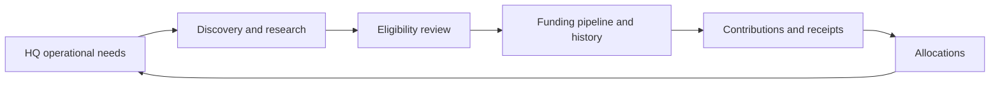

# Warriors Funding Desk

**Flagship project 2 · Funding workflows and systems integration**

An independent, AI-assisted Base44 application that connects funding discovery, eligibility review, pursuit tracking, contributions and allocation to operational needs.

## The problem I designed around

Finding a funding opportunity is only the beginning. Organizers must decide whether it fits, identify missing information, track the next action and deadline, and connect eventual support to the work it is intended to fund.

I designed Funding Desk as a companion to Hudson Valley Warriors HQ. HQ describes operational work and resource needs; Funding Desk organizes the research and funding workflow around those needs.

## My role

I led the 0→1 product definition, workflow architecture and integration design. That included defining discovery and pursuit states, separating eligibility from fit, modeling contributions and allocations, and specifying how funding records connect back to the operational system. I used Base44 and AI-assisted development to implement and refine the application.

Base44 provides the hosted backend and platform primitives. My contribution centers on the domain decisions, application workflows, business logic, integration contracts and iteration. This is independent project work, not a claim of enterprise deployment, commercial traction or sole manual code authorship.

## What I built

- Funding discovery with custom search filters and AI-assisted candidate research/enrichment.
- Eligibility review using organization facts, requirements, missing-information questions and freshness indicators.
- A funding workspace containing Pipeline, Watchlist, Grants, Loans, Needs, Received and Calendar views.
- Canonical lifecycle transitions and history that aim to preserve one pursuit as it moves through the workflow.
- Contribution records that distinguish committed or awarded support from cash received.
- Allocation editing across a Funding Need, Project or Program, with shared validation of target count and total allocation.
- Cross-app operational mirrors, contribution synchronization, retry handling and reconciliation with HQ.
- A paired demonstration mode with sample data and guarded external side effects.

## Architecture and product decisions

**Separate eligibility, fit and pursuit.** A relevant opportunity can still require evidence the organization has not supplied. The model separates requirements, organization facts and research findings so uncertainty can remain visible instead of being converted into a false yes/no answer.

**Move a pursuit without duplicating it.** Pipeline transitions use canonical records, linked legacy records and history rather than treating every view as an independent list. This supports continuity across discovery, watchlist, active work and outcomes.

**Connect funding to operational purpose.** Contributions can be allocated to needs, projects or programs. Shared helpers validate one target per allocation and prevent the allocation total from exceeding secured support. Target authorization and authoritative write enforcement still require hardening, so these helpers are not presented as a complete financial control system.

**Preserve meaning across applications.** Operational records use source identifiers and mappings. Funding updates normalize legacy award fields, distinguish receipts from commitments, and recompute totals. Content hashes suppress repeated unchanged pushes. Compatibility paths also support HQ-originated contribution edits; ownership is a design boundary with legacy paths to manage, not a universal single-writer guarantee.

**Make AI assist review.** Research functions retain source and confidence information, while eligibility review and pursuit decisions remain explicit workflows. Generated findings require human source verification. A demo score is labeled sample behavior and is not evidence that a live funding opportunity has been verified.

## A synthetic walkthrough

A program has an equipment need in HQ. Funding Desk receives its linked operational context. A candidate opportunity moves through review into the funding pipeline. A synthetic contribution is then recorded with separate committed and received amounts, allocated, and synchronized back to the operational need.

When the allocation changes or is removed, totals are recalculated. When the same unchanged funding record is pushed again, regression scenarios check that it does not create a second contribution or add the same amount twice.

This describes a tested workflow scenario. It does not represent a real grant award, completed application, donation or amount raised.

## Integrations and their limits

Implemented adapters connect HQ and Funding Desk, call Base44 AI services, communicate with an external agent service, and include Google Calendar and Microsoft Graph calendar operations. These are implementation capabilities, not a claim that every external account connection is currently configured or validated.

Calendar identity, cleanup scope, inbound authorization and financial permissions need additional verification and hardening before broader live use. The document area records metadata and external links; it is not presented as a secure managed document vault. No automated grant submission or payment-processing result is claimed.

## Evidence and current status

All seven checked-in Funding Desk regression files passed in a November 2026 repository review. Coverage includes allocation permission and target checks, conservative calendar cleanup, search-wrapper behavior, funding-position calculations, canonical pipeline moves, contribution synchronization, repeated-push suppression and demo boundaries.

Tests use mocked entities and synthetic requests. Live research accuracy, provider connectivity, deployed permissions, concurrency behavior and production readiness were not established by that review. The application remains in development.

## What this project demonstrates

- Modeling a multi-stage operational workflow from discovery through allocation.
- Separating evidence, eligibility, fit and action states.
- Designing linked applications with explicit data semantics and record identity.
- Handling retries and recalculation without treating repeated delivery as new funding.
- Defining useful test scenarios and communicating the limits of their evidence.

The next phase emphasizes stronger server-side authorization, allocation target validation, calendar safety, failure recovery and deployment-level tests.

## About this repository

This is a documentation-only portfolio case study. Application source, organizational records and deployment configuration remain private. It contains no actual fundraising results, member data or public application credentials.

Start with the flagship: [Hudson Valley Warriors HQ](https://github.com/VeteranSystems/hvw-hq-case-study).
